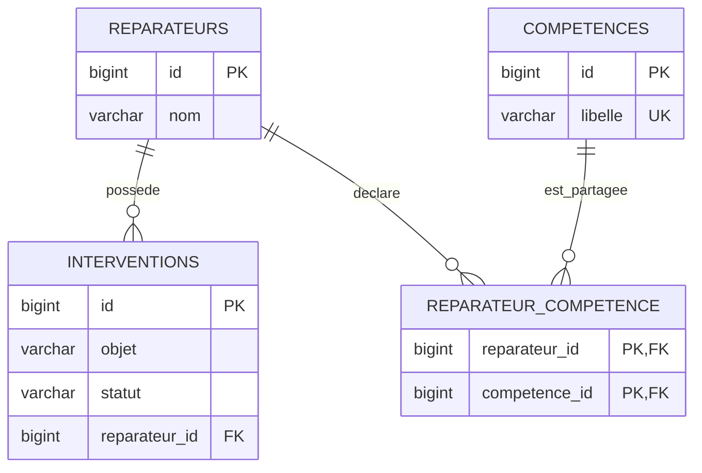
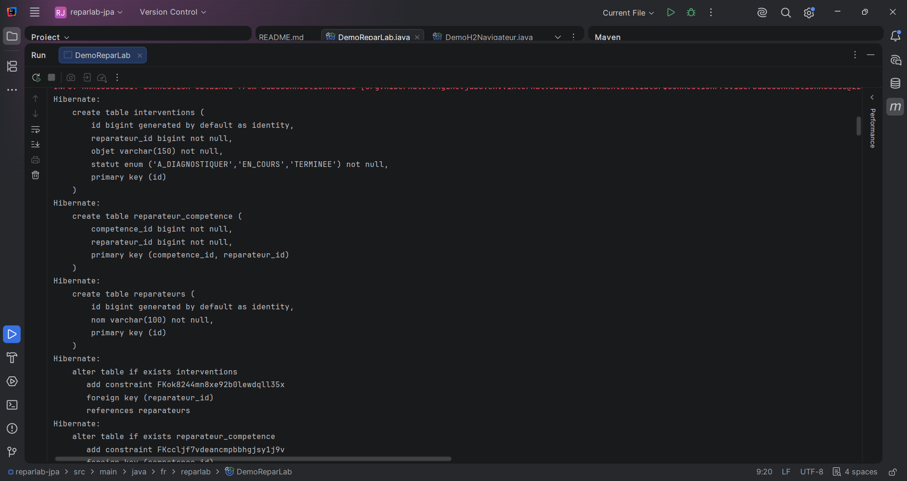
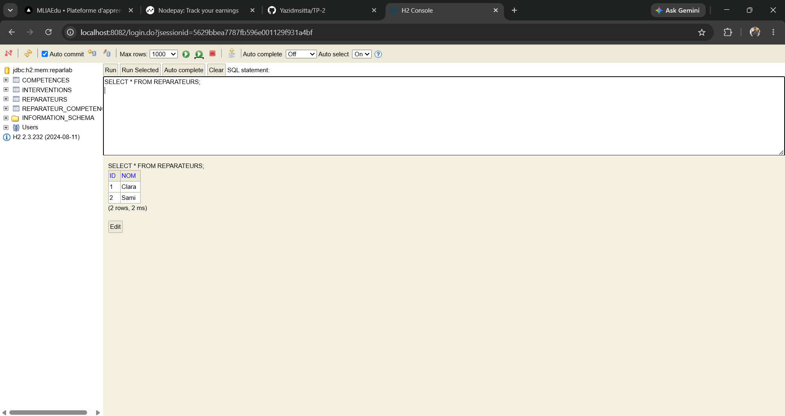
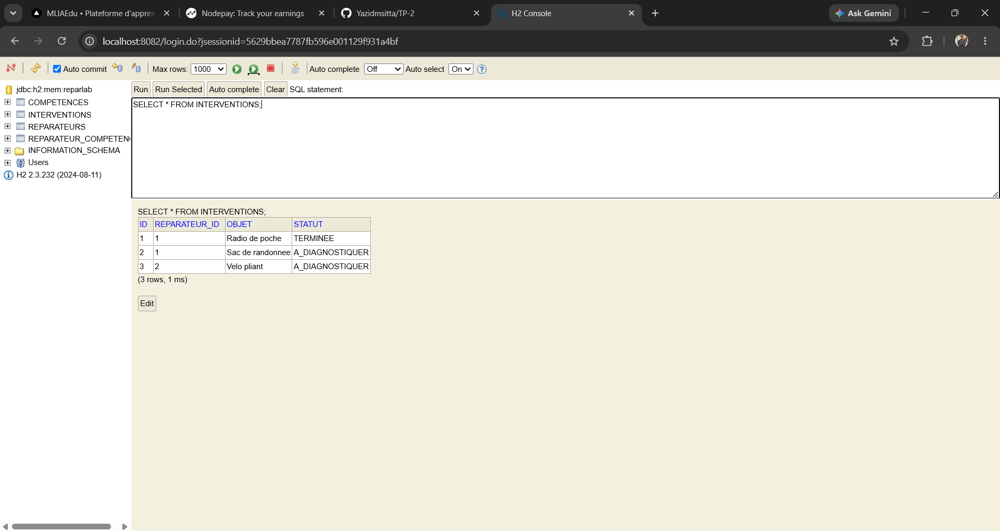

# Répar’Lab — Comprendre les relations JPA par la réparation solidaire

**TP corrigé • IntelliJ IDEA • Maven • Java 17 • Hibernate • H2**

Répar’Lab est le carnet d’une équipe de réparateurs bénévoles. Chaque réparateur conserve ses fiches d’intervention et déclare des compétences qu’il peut partager avec ses collègues. Le projet montre ce que deviennent les données quand on enregistre un carnet, modifie une fiche, retire une association ou supprime un réparateur.

Le scénario, les données d’exemple et les explications ont été rédigés pour ce TP. Les annotations et les conventions de programmation restent celles de JPA.

## 1. Livrables et objectifs

- Une application console complète, exécutable avec `DemoReparLab.main()`.
- Un [énoncé progressif](TP.md) pour refaire le travail et comprendre chaque choix.
- Trois entités et une table d’association, avec relations bidirectionnelles.
- Cinq étapes de démonstration qui contrôlent la base après chaque commit.
- Neuf tests : sept tests d’intégration H2 et deux tests de synchronisation des objets.
- Un compte rendu illustré par quatre captures réelles dans IntelliJ et H2.

À la fin, vous devez savoir distinguer le propriétaire d’une relation de son côté inverse, choisir les cascades en fonction du cycle de vie des objets, utiliser `orphanRemoval` et vérifier les effets réels d’une transaction.

## 2. Environnement retenu

| Outil | Version du projet / rôle |
|---|---|
| JDK | **17** ; compiler et exécuter le projet avec ce JDK |
| Maven | 3.9.x ou Maven intégré à IntelliJ |
| Jakarta Persistence | 3.1.0 ; API et annotations `jakarta.persistence` |
| Hibernate ORM | 6.6.58.Final ; implémentation JPA |
| H2 | 2.3.232 ; base en mémoire |
| JUnit Jupiter | 5.11.4 ; vérification des comportements |

L’énoncé initial indiquait « JDK 8 ou supérieur ». Cette réalisation choisit **Java 17** et ne compile pas sous Java 8. Elle emploie `jakarta.persistence`, le namespace qui succède à `javax.persistence` : ne mélangez pas les deux imports. Hibernate 6.6 est une branche à maintenance limitée, choisie ici pour un environnement pédagogique reproductible. [Compatibilité officielle Hibernate](https://hibernate.org/orm/releases/6.6/).

Il s’agit d’un TP de persistance Java/Jakarta EE exécuté en **Java SE**, avec transactions `RESOURCE_LOCAL`. Aucun serveur d’applications, Spring Boot, Tomcat, JSF ou abonnement IntelliJ n’est nécessaire pour lancer les classes et les tests Maven.

## 3. Démarrer dans IntelliJ IDEA

1. Décompressez l’archive si nécessaire.
2. Ouvrez **File → Open**, sélectionnez le dossier `reparlab-jpa` ou son `pom.xml`, puis ouvrez-le comme projet Maven.
3. Dans **File → Project Structure → Project**, choisissez **JDK 17**. S’il manque, utilisez **Add SDK / Download JDK**.
4. Dans **Settings → Build, Execution, Deployment → Build Tools → Maven**, conservez le Maven intégré. Pour **Runner → JRE**, choisissez le JDK du projet ; utilisez également le JDK 17 pour l’importateur Maven si ce réglage est affiché.
5. Dans la fenêtre **Maven**, cliquez sur **Reload All Maven Projects**. La première récupération des dépendances nécessite Internet.
6. Ouvrez `src/main/java/fr/reparlab/DemoReparLab.java`, puis cliquez sur le triangle vert à côté de `main`.
7. Vérifiez la présence de **`REPARLAB : TOUS LES SCENARIOS SONT VALIDES.`** en fin de démonstration. Les journaux de fermeture Hibernate peuvent suivre cette ligne.
8. Dans la fenêtre Maven, exécutez **Lifecycle → test**. Vous pouvez aussi lancer les classes de `src/test/java` avec leur triangle vert pour obtenir la vue graphique des tests.

Les noms exacts des boutons peuvent varier selon la version et la langue de l’IDE. [Documentation Maven d’IntelliJ](https://www.jetbrains.com/help/idea/maven-support.html).

### Depuis un terminal

Avec Maven disponible dans le `PATH`, placez-vous dans le dossier contenant `pom.xml` :

```shell
java -version
mvn -version
mvn clean test
mvn compile exec:java
```

Si `mvn` n’est pas reconnu dans le terminal, utilisez la fenêtre Maven d’IntelliJ : son Maven intégré fonctionne sans ajout au `PATH`. Pour lancer la démonstration depuis cette fenêtre, exécutez l’objectif `compile exec:java`.

### Voir H2 sur localhost et prendre les captures

1. Rechargez Maven après ouverture de cette version du projet.
2. Ouvrez `src/main/java/fr/reparlab/DemoH2Navigateur.java`.
3. Cliquez sur le triangle vert à côté de `main` → **Run DemoH2Navigateur**.
4. Attendez le message **`[PAUSE H2] 1 - Donnees initiales`** dans la console Run.
5. Ouvrez [http://localhost:8082](http://localhost:8082) dans votre navigateur.
6. Remplissez le formulaire comme suit, puis cliquez sur **Connect / Connexion** :

| Champ H2 | Valeur |
|---|---|
| Saved Settings / Paramètres enregistrés | `Generic H2 (Embedded)` si ce choix est proposé |
| Driver Class / Classe du pilote | `org.h2.Driver` |
| JDBC URL / URL JDBC | **`jdbc:h2:mem:reparlab`** |
| User Name / Nom d’utilisateur | `sa` |
| Password / Mot de passe | **Laisser vide** |

Remplacez l’URL proposée par défaut : `jdbc:h2:~/test` ne correspond pas à la base du TP. La console tourne dans la même JVM que Hibernate et accède donc à sa base en mémoire. [Fonctionnement de la console H2](https://h2database.com/html/tutorial.html).

Dans la zone SQL, collez ces requêtes et cliquez sur **Run / Exécuter** :

```sql
SELECT * FROM REPARATEURS ORDER BY ID;
SELECT * FROM INTERVENTIONS ORDER BY ID;
SELECT * FROM COMPETENCES ORDER BY ID;
SELECT * FROM REPARATEUR_COMPETENCE ORDER BY REPARATEUR_ID, COMPETENCE_ID;
```

Gardez la barre d’adresse `localhost:8082`, l’arborescence des tables et les résultats visibles pour la capture. Les [requêtes prêtes à copier](docs/captures/requetes-h2.sql) comprennent aussi le bilan des quatre tables et les jointures avec les noms des réparateurs.

Pour passer à l’étape suivante, revenez dans **la console Run d’IntelliJ**, cliquez dans cette console et appuyez **une seule fois sur Entrée**. Revenez au navigateur et **réexécutez les SELECT** pour actualiser les résultats. Répétez pour les cinq étapes. À la dernière pause, prenez la capture avant d’appuyer sur Entrée : le programme fermera ensuite la base et le serveur web.

Lancez une seule instance de `DemoH2Navigateur` à la fois. `DemoReparLab` reste le mode automatique ; il n’ouvre pas de console web sans l’argument `--console`. Depuis un terminal interactif, le mode web peut aussi être lancé avec `mvn compile exec:java "-Dexec.args=--console"`.

## 4. Modèle métier

Une **intervention** est une fiche interne appartenant au carnet d’un seul réparateur. Dans ce modèle pédagogique, elle est supprimée lorsqu’elle sort de ce carnet. Une **compétence** appartient à un catalogue commun et peut subsister même si aucun réparateur ne l’utilise.



Lecture sans rendu Mermaid : `Reparateur (1) ↔ (0..*) Intervention` et `Reparateur (0..*) ↔ (0..*) Competence`, via `reparateur_competence`.

| Attribut | Annotation | Propriété de la relation | Cycle de vie |
|---|---|---|---|
| `Reparateur.interventions` | `@OneToMany(mappedBy="reparateur")` | Côté inverse | `ALL`, `orphanRemoval=true` |
| `Intervention.reparateur` | `@ManyToOne` | Propriétaire ; porte la clé étrangère | Aucune cascade vers le parent |
| `Reparateur.competences` | `@ManyToMany` + `@JoinTable` | Propriétaire de l’association | `PERSIST`, `MERGE` |
| `Competence.reparateurs` | `@ManyToMany(mappedBy="competences")` | Côté inverse | Aucune cascade |

`mappedBy` désigne **le nom de l’attribut Java** de l’autre entité, pas le nom d’une colonne SQL. Le propriétaire de la relation décide de la mise à jour du lien en base ; il n’est pas nécessairement le parent métier.

## 5. Organisation des fichiers

```text
reparlab-jpa/
├── pom.xml
├── README.md
├── TP.md
├── docs/
│   ├── CORRIGE.md
│   └── captures/ (guide et requetes-h2.sql)
└── src/
    ├── main/
    │   ├── java/fr/reparlab/
    │   │   ├── DemoReparLab.java
    │   │   ├── DemoH2Navigateur.java
    │   │   ├── model/
    │   │   │   ├── Reparateur.java
    │   │   │   ├── Intervention.java
    │   │   │   ├── Competence.java
    │   │   │   └── StatutIntervention.java
    │   │   └── persistence/ (Jpa.java et ConsoleH2.java)
    │   └── resources/META-INF/persistence.xml
    └── test/java/fr/reparlab/
        ├── RelationsJpaTest.java
        └── SynchronisationTest.java
```

## 6. Expériences et résultats attendus

Clara possède deux fiches : **Radio de poche** et **Sac de randonnée**. Sami possède une fiche : **Vélo pliant**. Clara déclare **Électronique** et **Couture** ; Sami déclare **Électronique** et **Cycles**. Les deux partagent la même entité de compétence Électronique.

| Étape | Action | Réparateurs | Interventions | Compétences | Liens |
|---|---|---:|---:|---:|---:|
| 1 | Persister Clara et Sami | 2 | 3 | 3 | 4 |
| 2 | Fusionner le carnet détaché de Clara | 2 | 3 | 3 | 4 |
| 3 | Retirer la fiche Sac du carnet de Clara | 2 | 2 | 3 | 4 |
| 4 | Retirer la compétence Couture de Clara | 2 | 2 | 3 | 3 |
| 5 | Supprimer Clara et ses fiches restantes | 1 | 1 | 3 | 2 |

Ces chiffres sont contrôlés automatiquement par `verifierBilan`, dans un nouvel `EntityManager` après chaque commit. Un résultat différent déclenche une exception.

### Étape 1 — PERSIST

La démonstration appelle uniquement `em.persist(clara)` et `em.persist(sami)`. Les cascades enregistrent leurs fiches, les compétences nouvelles et les associations. Il reste bien **trois compétences**, et non quatre : Électronique est un objet partagé.

### Étape 2 — MERGE

Le carnet de Clara est chargé, ses collections sont initialisées, puis l’`EntityManager` est fermé. Le carnet devient détaché. La fiche Radio est ensuite marquée `TERMINEE` et `em.merge(detache)` propage sa modification. Le programme vérifie le statut dans une nouvelle transaction.

`merge` retourne une instance gérée ; l’instance passée en argument reste détachée. Sur une entité déjà gérée, une simple modification est détectée automatiquement au flush : aucun appel à `merge` n’est nécessaire.

### Étape 3 — Suppression orpheline

`clara.retirerIntervention(sac)` retire la fiche de la collection et met sa référence au réparateur à `null`. Avec `orphanRemoval=true`, Hibernate supprime cette fiche au flush. Le réparateur existe toujours. Aucune instruction `em.remove(sac)` n’est nécessaire.

### Étape 4 — Suppression d’une association

`clara.retirerCompetence(couture)` efface uniquement le lien. La compétence Couture reste dans le catalogue, même sans utilisateur. `orphanRemoval` n’est pas un attribut de `@ManyToMany`.

### Étape 5 — REMOVE

Les méthodes métier synchronisent le retrait des compétences, puis `em.remove(clara)` supprime Clara et ses fiches par cascade. Sami, sa fiche Vélo et les trois compétences restent présents. Mettre `CascadeType.ALL` sur les compétences propagerait aussi `REMOVE` vers des données partagées : cette configuration ne correspond pas au métier.

## 7. Synchronisation, transactions et chargement

Les méthodes `ajouterIntervention`, `retirerIntervention`, `ajouterCompetence` et `retirerCompetence` modifient les deux côtés des relations. Les collections sont exposées en lecture seule pour orienter l’utilisation vers ces méthodes. Les annotations sont placées sur les champs : JPA peut y accéder sans setters publics.

`Jpa.transaction` ouvre un contexte, commence la transaction, exécute l’action, effectue le commit et ferme l’`EntityManager`. En cas d’échec, il effectue un rollback. La factory est fermée par le `try-with-resources` de la démonstration.

Les collections restent en chargement différé. `Intervention.reparateur` demande également `LAZY`. Lisez les relations nécessaires dans la transaction ; accéder à une collection non initialisée après fermeture peut provoquer une `LazyInitializationException`.

Ce TP manipule une seule instance de chaque entité par contexte et ne redéfinit pas `equals/hashCode`. Un `Set` empêche ici de réinsérer le même objet ; il ne fusionne pas deux objets Java différents ayant le même libellé. Pour réutiliser une compétence déjà enregistrée, chargez-la avec `find` ou une requête au lieu d’en créer une nouvelle. Son libellé est unique en base.

## 8. Tests et lecture des résultats

```shell
mvn test
```

Résultat attendu : **9 tests, 0 échec, 0 erreur, 0 ignoré**. Chaque test d’intégration crée sa propre base H2. Les vérifications de persistance relisent les données après commit dans un nouveau contexte.

**Validation effectuée le 11 octobre 2026 :** compilation, neuf tests et cinq étapes de démonstration réussis avec Java 17 et Maven. Voir le [relevé de validation](docs/VALIDATION.md). Quatre captures de ton exécution sont intégrées à la section 9 ; la capture des tests reste à ajouter.

| Classe | Vérifications |
|---|---|
| `RelationsJpaTest` — 7 tests | Persistance du graphe, compétence partagée, suppression orpheline, retrait d’association, suppression du parent, cascade merge, rollback, absence de suppression du parent depuis une fiche |
| `SynchronisationTest` — 2 tests | Cohérence des références et collections, absence de doublon pour un même objet, rejet d’un autre propriétaire, modification depuis le côté inverse |

Les rapports Maven se trouvent dans `target/surefire-reports/` après exécution. La démonstration affiche le SQL ; les tests le désactivent pour rendre leurs résultats plus lisibles.

## 9. Captures de l’exécution dans IntelliJ et H2

Les quatre captures ci-dessous proviennent de l’exécution utilisateur. Elles montrent la création du schéma dans IntelliJ et les résultats de trois requêtes dans la console H2, connectée à `jdbc:h2:mem:reparlab` sur `localhost:8082`.

### Capture 1 — Création du schéma par Hibernate

La console Run d’IntelliJ affiche les instructions `CREATE TABLE` pour `interventions`, `reparateur_competence` et `reparateurs`. On voit également la clé étrangère `interventions.reparateur_id` vers `reparateurs` et la clé primaire composée de la table d’association.



### Capture 2 — Réparateurs enregistrés dans H2

La requête `SELECT * FROM REPARATEURS;` retourne deux lignes : **Clara**, identifiant 1, et **Sami**, identifiant 2.



### Capture 3 — Interventions et statut après modification

La requête `SELECT * FROM INTERVENTIONS;` affiche trois fiches. **Radio de poche** et **Sac de randonnée** sont rattachées au réparateur 1 ; **Vélo pliant** est rattaché au réparateur 2. La Radio est au statut **`TERMINEE`**, ce qui correspond au résultat attendu après l’étape MERGE. Les deux autres fiches restent au statut `A_DIAGNOSTIQUER` ; la fiche Sac est encore présente sur cette capture.



### Capture 4 — Catalogue des compétences

La requête `SELECT * FROM COMPETENCES;` retourne les trois compétences **Couture**, **Cycles** et **Électronique**. Cette vue montre le contenu du catalogue ; les liens avec chaque réparateur se consultent séparément dans `REPARATEUR_COMPETENCE`.


### Captures complémentaires possibles

Pour illustrer les autres expériences, les prochaines captures pourront montrer la table `REPARATEUR_COMPETENCE`, les bilans après suppression orpheline et dissociation, le bilan final après suppression de Clara et les neuf tests réussis. Les [requêtes H2](docs/captures/requetes-h2.sql) sont prêtes à copier.

## 10. Dépannage

| Symptôme | Action |
|---|---|
| `release version 17 not supported` | Affecter le JDK 17 au projet **et** au Maven Runner |
| Imports `jakarta.persistence` en rouge | Recharger Maven, vérifier Internet et les imports ; ne pas remplacer par `javax.persistence` |
| `No Persistence provider` | Vérifier `src/main/resources/META-INF/persistence.xml`, le nom `reparlab` et la synchronisation Maven |
| `mvn` inconnu | Utiliser la fenêtre Maven intégrée à IntelliJ |
| Base vide à la relance | Comportement normal : H2 en mémoire et `create-drop` recréent le schéma |
| Base H2 invisible dans un autre outil | La base `mem:` est locale au processus Java ; une console externe ne voit pas cette instance |
| `localhost:8082` inaccessible | Lancer `DemoH2Navigateur` et garder le programme en cours ; attendre la première pause |
| Port 8082 déjà utilisé | Arrêter l’ancienne instance H2 ou l’autre programme qui utilise ce port, puis relancer |
| `Database not found` dans H2 | Utiliser exactement `jdbc:h2:mem:reparlab` dans la console démarrée par `DemoH2Navigateur` |
| `LazyInitializationException` | Initialiser la relation ou exécuter la lecture avant de fermer l’`EntityManager` |

La configuration `create-drop` convient à ce TP : elle détruit le schéma lors de la fermeture de la factory. Ne l’utilisez pas pour conserver des données réelles. Ici, aucune base externe n’est configurée.

## 11. Bilan et prolongements

Le point essentiel est de distinguer une fiche dépendante, qui disparaît avec son carnet, d’une compétence partagée, qui doit rester disponible. Les tests rendent cette règle observable en base et montrent pourquoi toutes les associations ne doivent pas utiliser les mêmes cascades.

Pour poursuivre : ajouter une couche service, rechercher les réparateurs par compétence, examiner les requêtes produites par les lectures différées, puis construire une interface JSF/JSP avec un environnement adapté. Un véritable suivi historique des réparations demanderait une règle d’archivage au lieu de supprimer les fiches comme dans cet exercice.

## Références

- [Hibernate ORM 6.6 : compatibilité et versions](https://hibernate.org/orm/releases/6.6/).
- [Guide utilisateur Hibernate 6.6](https://docs.hibernate.org/orm/6.6/userguide/html_single/Hibernate_User_Guide.html).
- [Jakarta Persistence 3.1](https://jakarta.ee/specifications/persistence/3.1/).
- [Maven dans IntelliJ IDEA](https://www.jetbrains.com/help/idea/maven-support.html).
- [H2 : connexions et bases en mémoire](https://h2database.com/html/cheatSheet.html).
